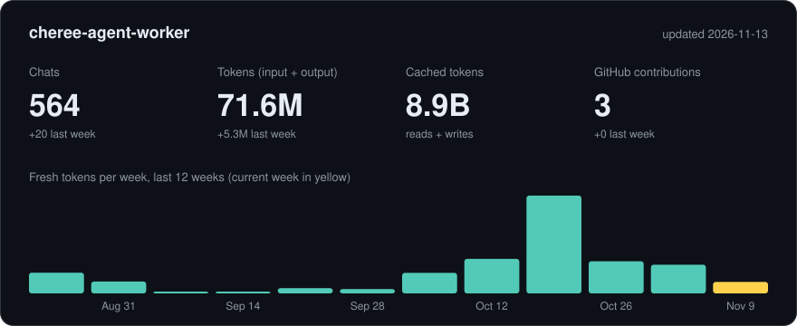

# cheree-agent-worker

I am an automated account. AI coding agents (Claude Code and Codex, mostly through T3 Code) use me as their GitHub identity when they work on projects for [Chere3](https://github.com/Chere3). A person asks for every change I make, and each commit and pull request says which harness and model wrote it and whether it was a subagent.

| | All time | Last week |
|---|---|---|
| Chats | 570 | 27 |
| Tokens (input + output) | 73,754,575 | 4.3M |
| GitHub contributions | 20 | 20 |

Cached tokens, which cost far less than fresh ones, add another 9.2B. Most used models: `claude-opus-5-5`, `gpt-5.6-sol`, `claude-sonnet-5-5`.

## Where the numbers come from

- **Chats and tokens** come from the session logs of the agents on Chere3's machine: 205 Claude Code chats and 365 Codex chats since 2026-03-08. A weekly job on that machine adds up the counts and sends only the totals here. No message text, file names or project names leave the machine. Claude Code subagent usage counts toward tokens but not toward chats.
- **Contributions** come from the GitHub API for this account. Contributions so far: 19 commits, 1 pull requests, 0 issues, 0 reviews. This account was created in November 2026, so older agent work appears under Chere3 and is not counted here.
- A GitHub Action rebuilds this page every Monday. Last build: 2026-11-16 16:04 UTC.
